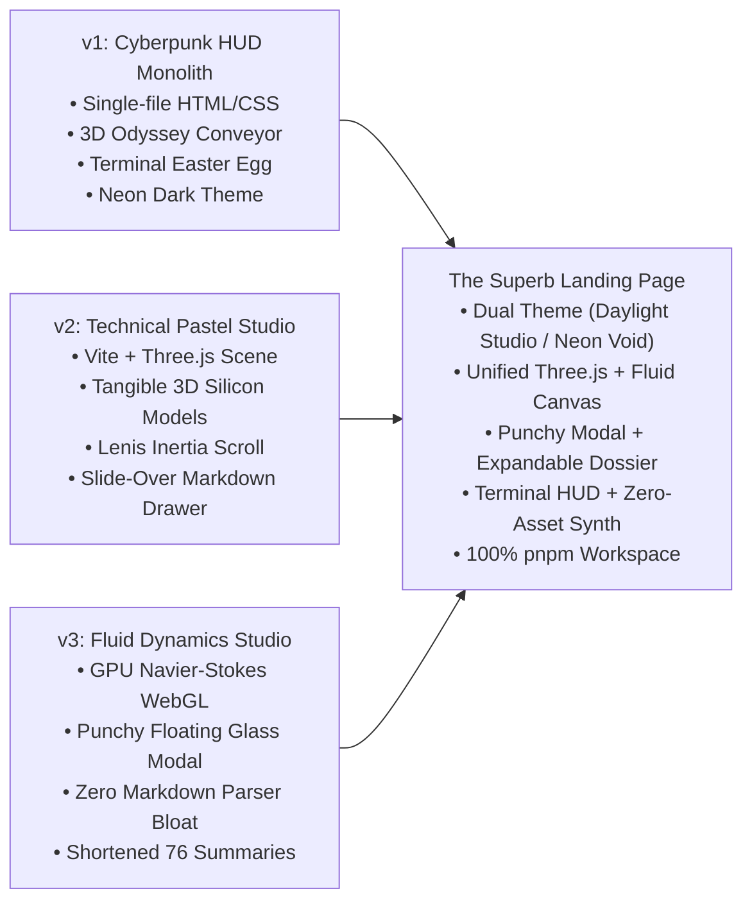

# Portfolio Architectural Synthesis: v1, v2, and v3

> **Author:** Antigravity AI & Sujay Seeram  
> **Repository:** `seeramsujay/sujayseeram`  
> **Target:** Monorepo analysis and unified blueprint for a superb landing page  
> **Core Tooling Mandate:** **pnpm ONLY** (strictly zero `npm` to protect laptop storage)

---

## 1. Executive Summary & Evolutionary Timeline

Over three successive iterations, the portfolio has explored different aesthetic philosophies, rendering technologies, and interaction models to showcase 76+ engineering projects spanning cyber-physical systems, TinyML, autonomous robotics, and edge AI.



---

## 2. Comprehensive Cross-Version Comparison Matrix

| Dimension | Version 1 (v1) | Version 2 (v2) | Version 3 (v3) |
| :--- | :--- | :--- | :--- |
| **Aesthetic Archetype** | Dark Cyberpunk HUD, electric neon gradients (mint/teal/cyan), scanlines, glass cards | Scandinavian Daylight Studio, soft technical pastels (mint, slate, lavender, butter amber) | Technical Pastel daylight studio with organic colorful fluid dye dynamics |
| **3D & WebGL Graphics** | CSS 3D transforms (`translateZ`, `rotateX`) driven by lerped scroll offset | Three.js WebGL scene: procedural ESP32 board, FFT wave, node graphs, core rings | Three.js WebGL narrative scene + custom GLSL Navier-Stokes fluid physics |
| **Modal / Project Detail** | Fullscreen HUD overlay with raw Markdown parsed via CDN `marked.js` | Full-height editorial slide-over drawer parsing full READMEs with bundled `marked.js` | Lightweight floating glass card modal backed by interactive GPU fluid canvas |
| **Project Summaries** | Long, technical README dossiers embedded directly in HTML | Medium-length Markdown files loaded per project | Punchy, shortened 1-2 sentence summaries + structured telemetry specs grid |
| **Audio & Haptics** | Silent (no audio engine) | Real-time procedural Web Audio synthesizer (`synth.js`, zero audio files) | Real-time procedural Web Audio synthesizer (`synth.js`, zero audio files) |
| **Easter Eggs & Depth** | Interactive Retro Cyber Terminal (`whoami`, `cat archive`, triggered by typing `build`) | None (focused purely on 3D narrative story stages) | Interactive fluid dye physics (click/drag creates swirls) |
| **Scroll Engine** | Custom requestAnimationFrame lerp loop with sticky CSS | Lenis smooth momentum scroll + GSAP ScrollTrigger | Lenis smooth momentum scroll + GSAP ScrollTrigger |
| **Package Tooling** | Zero-build static web standard (HTML + CSS) | Vite ESM bundler (`pnpm`) | Vite ESM bundler (`pnpm`, zero `marked` bloat) |
| **Storage & Weight** | ~670 KB total static HTML/CSS payload | ~850 KB JS/CSS bundle (due to `marked` chunk) | ~520 KB JS/CSS bundle (lean, fast parse) |

---

## 3. Deep Similarities & Shared DNA Across All Three

Despite differing visual languages and rendering pipelines, all three versions share fundamental pillars:

1. **The Single Source of Truth (`projects_db.json`):**
   - All three versions are powered by the same database of 76 verified engineering repositories.
   - Categories remain consistent: `Embedded Systems & Hardware`, `Agentic AI & Infrastructure`, `Autonomous Systems & Robotics`, `Sovereign Tools & Utilities`.
2. **The "Engineering Dossier" Mindset:**
   - Projects are never treated as mere portfolio gallery tiles; they are treated as **technical incident reports / hardware dossiers** featuring dates, team mandates (SIH, MoES, NIOT), and telemetry badges.
3. **Hardware-First Identity:**
   - Whether expressed via cyber HUD conduits (v1) or procedural ESP32 silicon geometry (v2/v3), the central narrative always highlights bare-metal firmware, edge DSP, and TinyML.
4. **Zero-Asset Sound Philosophy:**
   - Both v2 and v3 strictly generate 100% of their acoustic sound effects algorithmically through the Web Audio API, downloading zero audio files.

---

## 4. Strengths & Weaknesses Breakdown

### Version 1 (v1)
- **Top Strengths:**
  - **The Cyber Terminal (`build`):** Immensely memorable Easter egg that immediately establishes software/systems credibility.
  - **Odyssey Chronological Conduit:** The vertical illuminated conduit with year chips (`2026`, `2025`, `2024`) provides great chronological storytelling.
  - **Vault Category Matrix:** Very natural desktop & mobile filter tabs with clear project count badges.
  - **Reading Room:** Clean accordion list for technical papers and whitepapers with copy-to-clipboard buttons.
- **Key Weaknesses:**
  - Monolithic single-file HTML makes it hard to maintain.
  - Embedded readmes inflate the initial HTML download.
  - Dark-mode cyberpunk can blend into common developer portfolio tropes.

### Version 2 (v2)
- **Top Strengths:**
  - **Breathtaking Visual Identity:** The Technical Pastel daylight studio aesthetic is fresh, sophisticated, and memorable.
  - **Physical 3D Silicon Geometry:** The oversized ESP32 circuit board and FFT acoustic waves visually demonstrate hardware engineering prowess.
  - **Lenis + GSAP Inertia:** Butter-smooth scrolling across desktop.
- **Key Weaknesses:**
  - Bundle size penalty from bundling `marked.js`.
  - The full slide-over drawer covers the entire page and can feel slow to navigate when skimming many projects.

### Version 3 (v3)
- **Top Strengths:**
  - **Delightful WebGL Fluid Dynamics:** Swirling colorful fluid dye behind project cards provides instant tactile pleasure.
  - **Punchy Summaries:** 1-2 sentence engineering summaries allow recruiters to review 10 projects in 30 seconds.
  - **Zero Parser Bloat:** Complete elimination of `marked.js` makes the client lean and fast.
- **Key Weaknesses:**
  - Dual WebGL pipelines (Three.js canvas + Fluid canvas) require careful GPU optimization on mobile.
  - Loss of deep Markdown documentation if an engineering lead wants to read a full schematic breakdown.

---

## 5. The Blueprint for the "Superb Landing Page"

To create the ultimate portfolio experience, we extract the signature strengths from all three versions and fuse them into a cohesive masterpiece:

```
┌────────────────────────────────────────────────────────────────────────┐
│                   THE SUPERB LANDING PAGE BLUEPRINT                    │
├────────────────────────────────────────────────────────────────────────┤
│ 1. DUAL-THEME ENGINE (v1 Dark Cyberpunk HUD ⟷ v2/v3 Daylight Studio)  │
│    • Toggle between "Industrial Silicon Void" and "Studio Lab"         │
├────────────────────────────────────────────────────────────────────────┤
│ 2. 3D HARDWARE HERO (From v2/v3)                                       │
│    • Three.js interactive ESP32, FFT Acoustic Wave, & Node Constellation│
│    • Lenis momentum scroll linked to camera choreography               │
├────────────────────────────────────────────────────────────────────────┤
│ 3. TIMELINE CONDUIT & VAULT MATRIX (From v1)                           │
│    • Year-based chronological milestones + category filter chips       │
│    • Mobile-optimized swipeable pill tabs                              │
├────────────────────────────────────────────────────────────────────────┤
│ 4. HYBRID PROJECT DOSSIER MODAL (From v3 + v1)                         │
│    • Primary view: Floating glass card with WebGL fluid backdrop (v3) │
│    • Secondary tab: "Deep Specs / Full Dossier" Markdown view (v1)    │
│    • Zero bundle bloat: Lazy-load parser only if Deep Specs is clicked │
├────────────────────────────────────────────────────────────────────────┤
│ 5. RETRO TERMINAL EMULATOR (From v1)                                   │
│    • Keyboard shortcut `build` opens system telemetry shell            │
│    • Interactive commands (`whoami`, `cat projects`, `specs`)          │
├────────────────────────────────────────────────────────────────────────┤
│ 6. ZERO-ASSET AUDIO SYNTHESIZER (From v2/v3)                           │
│    • Real-time Web Audio clicks, sweeps, and stage transitions         │
│    • Global persistent mute switch                                     │
├────────────────────────────────────────────────────────────────────────┤
│ 7. STRICT TOOLING & STORAGE EFFICIENCY                                 │
│    • 100% pnpm workspace monorepo (zero duplicate node_modules)        │
│    • Shared global pnpm store protecting laptop disk storage           │
└────────────────────────────────────────────────────────────────────────┘
```

---

## 6. Monorepo Storage & Tooling Guide (pnpm Only)

### Why pnpm is Mandatory on this Machine
1. **Hardlink Content-Addressable Storage:** Unlike `npm` (which duplicates hundreds of megabytes of identical `node_modules` in every subfolder), `pnpm` stores files only once in a global content-addressable store (`~/.local/share/pnpm/store`) and creates hardlinks.
2. **Disk Space Conservation:** Running three separate versions with npm would consume ~1.5 GB of disk space. With pnpm, the incremental disk usage is practically zero.

### Developer Commands Quick Reference

```bash
# Verify pnpm is installed and active
pnpm --version

# Run v2 development server
cd v2 && pnpm dev

# Run v3 development server
cd v3 && pnpm dev

# Build production bundle for v3
cd v3 && pnpm build

# Never run npm install! Always use:
pnpm install
```

---

## 7. File Structure Overview

```
sujayseeram/
├── PORTFOLIO_SYNTHESIS.md       # Master architectural blueprint and version comparison (this file)
├── README.md                    # Primary repository overview
├── index.html                   # Root production entrypoint (v1 optimized without scramble lag)
├── index.css                    # Root production stylesheet
├── projects_db.json             # Master canonical database (76 projects)
├── v1/                          # Version 1: Cyberpunk Monolith HUD
│   ├── README.md                # Dedicated v1 architectural documentation
│   ├── index.html               # v1 source HTML with top-of-file docstring
│   ├── index.css                # v1 stylesheet with top-of-file docstring
│   └── robots.txt
├── v2/                          # Version 2: Technical Pastel Daylight Studio
│   ├── README.md                # Dedicated v2 architectural documentation
│   ├── package.json             # Modular dependencies (Three.js, GSAP, Lenis, Marked)
│   ├── vite.config.js           # Vite build config with docstring
│   ├── index.html               # v2 entrypoint with docstring
│   └── src/                     # All JS modules, styles, and audio with top docstrings
└── v3/                          # Version 3: Technical Pastel & WebGL Fluid Dynamics
    ├── README.md                # Dedicated v3 architectural documentation
    ├── package.json             # Lean modular dependencies (zero marked parser bloat)
    ├── vite.config.js           # Vite build config with docstring
    ├── index.html               # v3 entrypoint with docstring
    └── src/                     # All JS modules, WebGL fluid shaders, and styles with top docstrings
```
