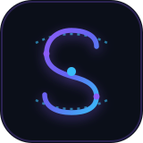

<p align="center">
  
</p>

<h1 align="center">Sujay Seeram (Suzaykid)</h1>

<p align="center">
  <strong>Cyber-Physical Systems · Physics-Informed Computing · Extreme Economic Engineering</strong>
</p>

<p align="center">
  <a href="https://sujayseeram.com"></a>
  
  
  
</p>

---

👋 Hi, I am **Sujay Seeram** (Suzaykid). I am an Electronics and Communication Engineering student at Amrita Vishwa Vidyapeetham, specializing in resource-constrained cyber-physical systems, embedded hardware design, and physics-informed computing.

---

## ⚡ The Philosophy: Extreme Economic Engineering

I apply physics first principles to build highly economical, hardware-optimized devices and algorithms. I believe in maximizing system capabilities while minimizing physical component counts and computational overhead.

```
       [ Mathematical Theory & Physics First Principles ]
                             │
                             ▼
     [ Economical Hardware: Minimalist Component Budgets ]
                             │
                             ▼
    [ Sovereign Intelligence: Low-Compute Local Frameworks ]
```

---

## 🎯 Primary Focus Areas

- **Physics-Informed Computing**: Embedding dynamical physical models directly into neural network structures, generative VAE models, and local control loops.
- **Embedded Hardware & Microcontrollers**: Constructing sensor integrations, biometric rings, automatic spot welders, and Esp32-based voice satellites.
- **Sovereign Local Systems**: Architecting local document retrieval engines (RAG) and API gates designed to execute on lightweight, non-GPU host machines.

---

## 🛠️ Selected Space Repositories

| Repository | Scope | Core Stack |
| :--- | :--- | :--- |
| **[Slingshot](https://github.com/seeramsujay/slingshot)** | Adaptive Urban Dust Mitigation Framework | Python, Scikit-Learn, FastAPI |
| **[EVolvAI](https://github.com/seeramsujay/EVolvAI)** | Physics-Informed Generative EV Demand Pipeline | PyTorch, Streamlit, Genetic GA |
| **[specRAG](https://github.com/seeramsujay/specRAG)** | Zero-Hallucination Firmware Auditing Gateway | SQLite, local-rag, Python |
| **[smartRing](https://github.com/seeramsujay/smartRing)** | Open-Source Biometric Hardware Interface | ESP32, Low-Power C++, I2C |
| **[healthcare-android-ai](https://github.com/seeramsujay/healthcare-android-ai)** | Unified Medical Screening Architecture | FastAPI, TFLite, Flutter |

---

## 🗂️ Repository Layout

```
site/                 ← the only folder that gets deployed (see netlify.toml)
  index.html          page markup + inline project timeline data
  css/site.css        styles
  js/site.js          interactions (scroll engine, overlays, theme)
  data/readmes.json   full project READMEs, lazy-loaded on first project open
  assets/             logo / favicon
tools/                manage_projects.py, test_gemini_api.py, perf-check.mjs
tests/                pytest suite for the tooling
docs/                 roadmap, performance budget, branching model, design notes
projects_db.json      source of truth for projects
```

**Branches:** `main` is the live site. `v2` and `v3` hold the next-generation
Vite builds; `archive/v1` keeps the older v1 snapshot. See
[docs/BRANCHING.md](docs/BRANCHING.md).

**Preview locally:** `python3 -m http.server -d site 8000` then open http://localhost:8000
(opening the file directly works too, but project READMEs need a server to load).

**Check smoothness:** `node tools/perf-check.mjs --label mychange` — see
[docs/PERFORMANCE.md](docs/PERFORMANCE.md).

---

## 🚀 Quickstart & Project Automation

This repository includes an automated portfolio management pipeline ([`manage_projects.py`](tools/manage_projects.py)) that reconciles GitHub repositories, generates AI descriptions with Gemini, and synchronizes [`projects_db.json`](projects_db.json) into the site (timeline data inline in [`site/index.html`](site/index.html), full READMEs in `site/data/readmes.json`).

### 📦 Setup & Dependency Management

The project uses modern, reproducible packaging supporting both [**uv**](https://github.com/astral-sh/uv) and standard **pip**:

- **[`pyproject.toml`](pyproject.toml)**: Standard PEP 517/621 project specification with `google-genai` and `google-generativeai`.
- **[`uv.lock`](uv.lock)**: Deterministic, pinned lockfile for instantaneous environment reproduction.
- **[`requirements.txt`](requirements.txt)**: Fallback compatibility for traditional pip virtual environments.
- **[`.env.example`](.env.example)**: Starter configuration template for environment variables.

#### Option A: Using `uv` (Recommended)
```bash
# Clone the repository
git clone https://github.com/seeramsujay/sujayseeram.git
cd sujayseeram

# Sync virtual environment directly from lockfile
uv sync
```

#### Option B: Using Standard `pip`
```bash
python3 -m venv .venv
source .venv/bin/activate
pip install -r requirements.txt
```

---

### ⚙️ Configuration (Optional)

Copy the template environment file:
```bash
cp .env.example .env
```

| Variable | Description | Default |
| :--- | :--- | :--- |
| `GEMINI_API_KEY` | *(Optional)* Used for AI analysis of repository READMEs and auto-tagging. If not provided, repository defaults are used. | `None` |
| `GITHUB_USERNAME` | *(Optional)* GitHub account handle to query public repositories from. | `seeramsujay` |

---

### 🛠️ Portfolio Manager Pipeline (`manage_projects.py`)

Launch the interactive Terminal UI (TUI):
```bash
# With uv
uv run tools/manage_projects.py

# Or with activated venv
python3 tools/manage_projects.py
```

#### Key Capabilities & Fault Tolerance:
- **No Startup Crash**: Operates smoothly without a `GEMINI_API_KEY` for browsing, reviewing, and toggling visibility of existing projects.
- **Dual SDK Support**: Uses modern `google-genai` with fallback to `google-generativeai` and multi-model fallbacks (`gemini-3.1-flash-lite`, `gemini-2.5-flash`, `gemini-2.0-flash`).
- **Graceful GitHub CLI Fallback**: If `gh` is missing, unauthenticated, or offline, the tool warns gracefully and continues using existing records in [`projects_db.json`](projects_db.json).
- **Self-Contained DB Recovery**: If `projects_db.json` is missing, it automatically extracts and reconstructs the database directly from [`index.html`](site/index.html).
- **Automated Browser Preview & Git Push**: After commissioning changes, it automatically opens `site/index.html` in Zen browser for preview, prompts to upload (`Y/n`), and commits (`"update new projects"`) and pushes directly to GitHub.

#### TUI Keyboard Controls:
- `Up` / `Down` or `k` / `j`: Navigate repository list
- `[p]`: Set to **Public** (displayed on main timeline with GitHub link)
- `[v]`: Set to **Private** (displayed on main timeline without GitHub link)
- `[a]`: Set to **Archive** (moved to the Vault section)
- `[d]`: Set to **Nuked** (opted-out / hidden completely)
- `[s]`: Save changes, update `projects_db.json` & `site/`, preview in Zen browser, and optionally push to GitHub
- `[q]`: Quit without saving

---

### 🧪 Verifying Gemini API (`test_gemini_api.py`)

Test your Google Gemini connection and key validity:
```bash
uv run tools/test_gemini_api.py
# Or pass key directly:
uv run tools/test_gemini_api.py YOUR_API_KEY
```

---

## 🛡️ Licensing & Privacy Safeguards

This repository, its layouts, and all associated personal portfolio contents operate under strict digital sovereignty covenants.

> [!CAUTION]
> **Prohibitions on AI Training & Scraping**
> All original materials in this repository are licensed under the **Personal Content and Privacy Protection License (PCPPL)**.
> - **NO Ingestion**: Ingestion of these layouts, text, code, or assets to train, fine-tune, or validate machine learning models (including LLMs) is strictly prohibited.
> - **NO Scrapers**: Automated crawling, harvesting, scraping, or indexing by scripts, spiders, or bots is banned.
> - **Portfolio Use Only**: Human review for recruiter or portfolio evaluation purposes is welcome.

---

## 📬 Connection Coordinates
- **Email**: `sujayat2007@gmail.com`
- **Identity**: Suzay / Tubelight / Professional Larper